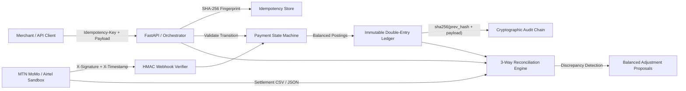

# FlowLedger

[](https://github.com/codesphere-u/flowledger/actions/workflows/ci.yml)
[](https://www.python.org/)
[](LICENSE)
[](docs/architecture.md)

**FlowLedger** is an African Payment Orchestration & Immutable Double-Entry Reconciliation Engine built in Python. It models mobile money collection and settlement workflows (`MTN MoMo`, `Airtel Money`) across East and West African currencies (`UGX`, `KES`, `NGN`, `USD`) with strict mathematical accounting invariants, idempotency guarantees, cryptographic webhook verification, and automated 3-way reconciliation.

---

## Architectural Highlights

1. **Immutable Double-Entry Accounting (`flowledger/ledger/`)**
   - Five canonical account classes (`ASSET`, `LIABILITY`, `REVENUE`, `EXPENSE`, `EQUITY`) tracked strictly in **integer minor units** — zero IEEE-754 floating-point rounding bugs.
   - Every state-changing financial event records a balanced `JournalEntry` containing two or more `LedgerPosting` legs where $\sum \text{Debits} \equiv \sum \text{Credits}$ is enforced prior to commit.
   - Tamper-evident cryptographic audit chain: every entry computes `entry_hash = sha256(prev_hash + canonical_payload)` starting from `GENESIS_HASH` (`"0" * 64`).

2. **Deterministic Payment State Machine (`flowledger/payments/state_machine.py`)**
   - Formal lifecycle graph: `INITIATED` $\rightarrow$ `PENDING_PROVIDER` $\rightarrow$ `AUTHORIZED` $\rightarrow$ `SETTLED` | `FAILED` | `REVERSED` | `DISPUTED`.
   - Safely handles **out-of-order webhooks** (e.g., `SETTLED` callback arriving before `AUTHORIZED` callback automatically records the implicit authorization leg and absorbs the delayed `AUTHORIZED` webhook as an idempotent no-op).
   - Prevents illegal transitions such as `FAILED` $\rightarrow$ `SETTLED` unless an explicit reconciliation exception override is authorized.

3. **Idempotency & Request Fingerprinting (`flowledger/payments/idempotency.py`)**
   - Binds each `idempotency_key` to a canonical SHA-256 request payload digest.
   - Duplicate retries with an identical payload deterministically replay the cached response; reusing an `idempotency_key` with a mutated payload raises `IdempotencyConflictError` (`HTTP 409 Conflict`).

4. **Cryptographic Webhook Verification & Sandbox Providers (`flowledger/providers/`)**
   - Constant-time HMAC-SHA256 verification (`X-Signature`, `X-Timestamp`) with configurable replay-window enforcement and optional nonce deduplication.
   - Includes `MtnMomoSandboxAdapter` and `AirtelMoneySandboxAdapter` with realistic fee tiers, exponential backoff with deterministic jitter, and a **Failure Injection Simulator** (`DUPLICATE_WEBHOOK`, `OUT_OF_ORDER_WEBHOOK`, `PROVIDER_TIMEOUT_RETRY`, `FEE_MISMATCH`, `MISSING_IN_LEDGER`, `MISSING_AT_PROVIDER`, `AMOUNT_MISMATCH`, `CUSTOMER_REVERSAL`).

5. **Automated 3-Way Reconciliation Engine (`flowledger/reconciliation/engine.py`)**
   - Continuously reconciles **(1) Internal Payment Intent Orders**, **(2) Double-Entry Ledger Postings**, and **(3) External Provider Settlement Statements (CSV/JSON)**.
   - Classifies every transaction into `MATCHED`, `MISSING_IN_LEDGER`, `MISSING_AT_PROVIDER`, `AMOUNT_MISMATCH`, `FEE_DISCREPANCY`, or `STALE_UNSETTLED`, and generates balanced **Adjustment Journal Proposals**.

---

## What's New in v2.0

- **Pan-African rails**: Safaricom M-Pesa Daraja (STK Push, C2B, B2C) payload builders/parsers; Wave, Orange Money, MTN GH/RW, Tigo TZ profiles; new currencies `GHS ZAR TZS RWF XOF XAF USDC EURC`.
- **ISO 20022** `pacs.008` / `pacs.002` generate + parse alongside CAMT.053.
- **Cross-border FX**: rate-locked, single-use quotes posted as balanced journals with spread revenue.
- **Offline vouchers**: HMAC-signed, replay- and nonce-protected, bulk settlement queue.
- **Compliance**: fuzzy sanctions/PEP screening and structuring/velocity detection.
- **Durability & audit**: SQLite WAL store with hash-verified restore; RFC 6962 Merkle inclusion proofs.
- **MCP**: 12 tools for AI agents.

> Provider modules build and parse payloads offline; they do not call live APIs. See [Limitations](docs/limitations.md) for exactly what is and isn't production-ready.

## System Architecture



---

## Quickstart

### 1. Run the 50-Transaction East African Mobile Money Simulation & Audit

```bash
uv run --with fastapi --with httpx --with pydantic python -m flowledger.cli demo
```

### 2. Verify Mathematical Zero-Sum & Hash-Chain Invariants

```bash
uv run --with fastapi --with httpx --with pydantic python -m flowledger.cli verify-invariants
```

### 3. Launch the Interactive Financial Operations Dashboard

```bash
uv run --with fastapi --with uvicorn --with httpx --with pydantic python -m flowledger.cli serve --port 8095
```

Open `http://127.0.0.1:8095` to inspect live double-entry accounts, inject webhook anomalies, and run 3-way reconciliation in real time.

### 4. Run the Test Suite (94 Unit, Invariant, Security & API Tests)

```bash
uv run --with pytest --with fastapi --with httpx --with pydantic pytest -v
```

---

## Documentation Index

- [Architecture & Data Flow](docs/architecture.md)
- [v2.0 Architecture Additions](docs/v2-architecture.md)
- [ADR-001: Integer Minor Units & Double-Entry Invariants](docs/decisions/001-integer-minor-units-and-double-entry-invariants.md)
- [Testing & Verification Guide](docs/testing.md)
- [Operational Scope & Known Limitations](docs/limitations.md)
- [Security Policy](SECURITY.md)

## License

Released under the [MIT License](LICENSE).
